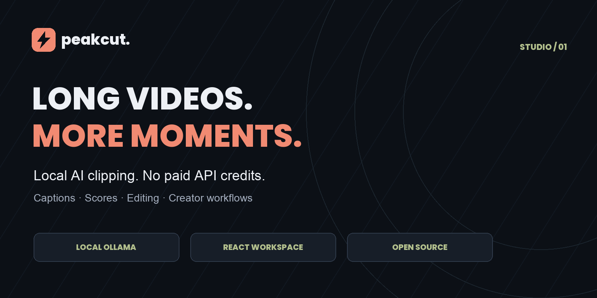
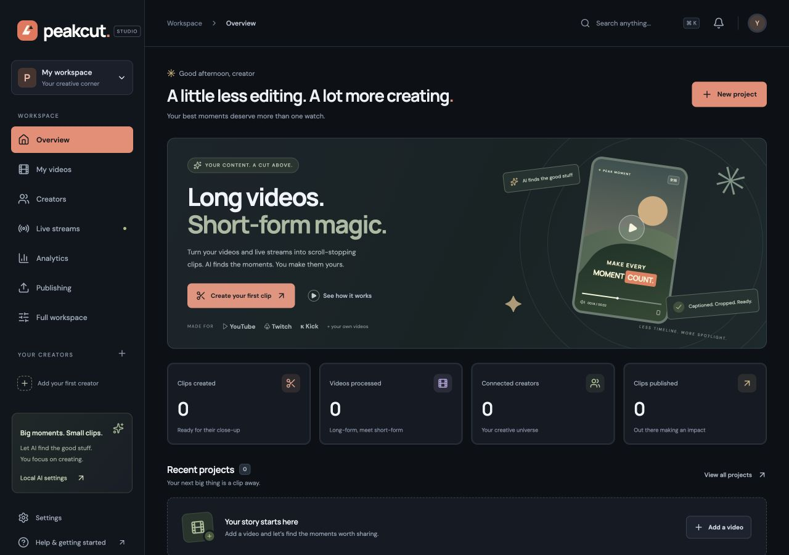
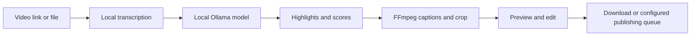
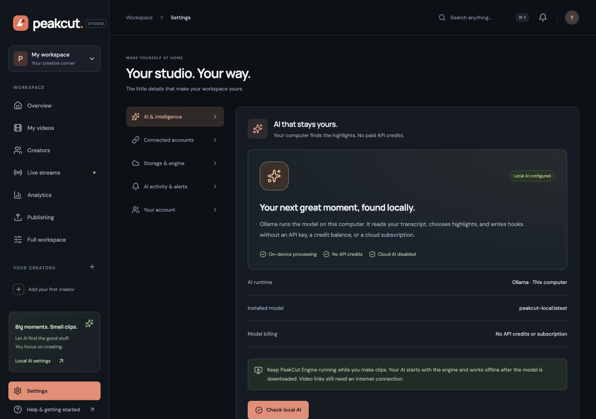

<div align="center">



# PeakCut Studio

### Turn long videos into captioned clips—with AI running on your computer.

**No paid AI API credits. A dark React workspace. Your own local video engine.**

[Explore the interface](https://peakcut-studio-chi.vercel.app/) · [Watch the 40-second demo](https://github.com/sasukefrontenddev/peakcut-studio/releases/download/v1.0.0-studio/PeakCut-Studio-Instagram-Reel.mp4) · [Get started](#quick-start) · [Feature coverage](FEATURE-PARITY.md) · [Original PeakCut](https://github.com/haziqahmedqasmi/PeakCut)

[](LICENSE)
[](#local-ai-setup)
[](#built-with)

</div>

PeakCut Studio is a redesigned interface for [PeakCut](https://github.com/haziqahmedqasmi/PeakCut), the open-source video and live-stream clipping engine by Haziq Ahmed Qasmi. Upload a video or paste a supported link, find the highlights, and turn them into vertical clips with captions, hooks, and titles.

The website runs on Vercel. **Your computer does the video processing and local AI work.** The public demo shows the interface; it is not a shared cloud video processor and does not include access to anyone else’s engine.



## Why use it?

- **Local AI, without paid API credits.** Ollama runs the clip-selection model on your machine; transcription is local too. After model downloads, uploaded files can be processed offline.
- **Long-form to vertical.** Import YouTube, Twitch, and Kick links, or upload a video. Generate 9:16 clips with three caption styles and three layouts.
- **Understand the pick.** See an AI highlight score out of 100 and its reason. Scores estimate clip appeal; they do not guarantee views. Fallback clips are identified separately.
- **Make it yours.** Preview, trim, change the hook/title/description, adjust captions and framing, rerender, and download.
- **A workspace per creator.** Keep channels, clipping rules, live thresholds, activity, and posting rules together.
- **Live highlights.** Record supported streams, clip the last 30 seconds, or let the engine use transcript, loudness, and chat activity to find moments.
- **A publishing desk.** Queue clips, retry failures, pause posting, and configure creator automation with score thresholds, spacing, and daily caps. Platform setup is required; see below.
- **The original tools are included.** Open **Full workspace** for bulk downloads/deletion, storage migration, detailed creator views, and the original account/admin tools.

## How it works



The React app talks to a private loopback connector on your computer. Pairing requires the exact approved website origin and a random browser key. API requests and media previews go directly to your local engine; videos are not uploaded to Vercel for processing. Social platforms receive videos only through configured publishing actions.



## Quick start

### Requirements

- Node.js **22.12+** and Python **3.10+**.
- FFmpeg and FFprobe on your executable path, or supplied through the private local config.
- [Ollama](https://ollama.com/) and enough disk/RAM for the speech and language models. Performance depends on your hardware, video length, and other running apps.

The commands below use macOS/Linux shell syntax. Windows users can run the Python backend directly or adapt the virtual-environment path.

```sh
git clone https://github.com/sasukefrontenddev/peakcut-studio.git
cd peakcut-studio
npm ci
python3 -m venv backend/.venv
backend/.venv/bin/pip install -r backend/requirements.txt
```

### Local AI setup

Download the language model once and create PeakCut’s local model:

```sh
ollama pull qwen2.5:3b
ollama create peakcut-local -f engine/Modelfile
```

Create **`.engine-local.json`** in the project root. Replace the example paths with absolute paths on your machine:

```json
{
  "ollama": "/absolute/path/to/ollama",
  "ollamaModels": "/absolute/path/to/your/ollama/models",
  "aiModel": "peakcut-local:latest"
}
```

Use the model directory where the commands above downloaded the model. Ollama normally uses `~/.ollama/models`; expand `~` to your full home path in JSON. Optional `python`, `ffmpeg`, `models`, and `data` fields select the Python executable, FFmpeg directory, speech-model directory, and engine data directory. `PEAKCUT_PYTHON` can also select Python.

The launcher starts Ollama if needed, disables cloud features for the Ollama process it starts, and configures PeakCut to use the local model without an API key. The bundled model uses CPU processing. If you start Ollama yourself, use `OLLAMA_NO_CLOUD=1` for that process as well.

### Start and connect

```sh
npm run engine
```

1. Open [the local connection page](http://127.0.0.1:8767) on the same computer.
2. Click **Connect PeakCut Studio** and allow local-network access if the browser requests it.
3. Open **Settings → AI & intelligence → Check local AI**.
4. Add a video. Keep the engine running and the computer awake while processing.

The speech model downloads on first start. The local engine’s complete original interface is available at [127.0.0.1:8765/app](http://127.0.0.1:8765/app). You can also use `start-engine.command` on macOS.

> A new deployment hostname needs corresponding changes to the exact origin allowlists in `engine/bridge.mjs` and `src/api.js`. The bundled pairing page connects to the published PeakCut Studio hostname. Do not use wildcard origins.

## Social accounts and direct publishing

Open **Settings → Connected accounts → Set up** for the platform you want. The setup screens show the developer-console link, required permissions, callback address, and private app-credential form. App secrets and account tokens stay with the engine.

| Platform | What must be configured |
| --- | --- |
| YouTube | A Google Cloud OAuth client, YouTube Data API v3, consent/test-user setup, and any required platform verification. |
| Instagram | A Meta developer app, eligible Creator/Business account, publishing permissions, and the included free HTTPS sign-in/clip relay. |
| TikTok | Login Kit, Content Posting API / Direct Post, the included free HTTPS callback, and an audit for public posting. Unaudited apps have private-post restrictions. |

**Developer-app registrations are still required.** No paid hosting plan is needed for the connection:

- The Vercel site serves a stable HTTPS OAuth callback. The same paired browser forwards the one-time result to the local engine, which verifies its state and exchanges the code. App secrets and account tokens stay local.
- TikTok uploads video bytes directly from your computer.
- Instagram fetches expiring HMAC-signed clip links through an optional free Cloudflare Quick Tunnel. A dedicated gateway permits only those links and a small health check; `/api`, `/app`, OAuth starts, and other files are not exposed.

Download the official [cloudflared client](https://developers.cloudflare.com/cloudflare-one/networks/connectors/cloudflare-tunnel/downloads/), then add its absolute executable path as `"cloudflared"` in `.engine-local.json`. The engine launcher starts the restricted clip relay automatically. The tunnel address may change after restart; the Vercel callback remains stable, so the platform callback does not need changing. Keep the engine running while connecting/publishing. Quick Tunnels have no uptime guarantee and are suitable for this personal local workflow, not a production availability promise.

Register `https://peakcut-studio-chi.vercel.app/oauth/instagram/callback` and `https://peakcut-studio-chi.vercel.app/oauth/tiktok/callback` in the relevant developer apps. A self-hosted frontend must set its own HTTPS `PEAKCUT_SOCIAL_CALLBACK_ORIGIN` and exact connector origin allowlists. No platform review or permission requirement is bypassed.

After connection, open a finished clip → **Publish clip**, select accounts, and choose **Post now** or **Add to queue**. Creator settings control automation, visibility, minimum score, spacing, and daily limits. See [feature coverage and verification](FEATURE-PARITY.md) for what has been tested and what remains platform-dependent.

## Development and checks

```sh
npm run dev
# Open http://127.0.0.1:5173

npm run build
npm run test:engine
npm run test:features
```

Vite forwards development API/media requests to the local Python engine on port 8765. The connector test checks origin/Host validation, key enforcement, and private-network preflight. React regression checks cover score provenance, safe text rendering, queue actions, automation fields, and account prerequisites. The unchanged upstream backend includes its own tests under `backend/tests/`.

## Deployment

Use the Vite preset on Vercel: build `npm run build`, output `dist`. This deploys the frontend only. The engine and models run separately on your computer. No paid video-hosting service is required for that arrangement; electricity, hardware, bandwidth, platform limits, and hosting-plan terms still apply.

There is no subscription billing in this project. Local AI does not consume a provider’s API credit balance. The original backend still supports optional external AI providers, but this interface is built around local Ollama.

## Privacy and troubleshooting

- Keep `.engine-local.json`, `.engine-pairing.json`, `.env`, platform secrets, models, and video data out of Git. They are ignored by default.
- The connector listens on `127.0.0.1`, checks the exact website origin and local Host header, and requires the pairing key. Public visitors do not gain access to your computer.
- If pairing fails, start the engine, use Chrome, allow local-network access, and reconnect from port 8767. The website and engine must be on the same computer/browser.
- If clips use loudness instead of AI, check Ollama, the installed model, and **Check local AI**. No paid provider is silently substituted by the local launcher.
- If a platform cannot connect, check its developer setup and callback requirements. Read the error before retrying.

## Built with

React · React Bits · Motion UI · Motion for React · Vite · FastAPI · Ollama · Qwen2.5 · sherpa-onnx/Parakeet · FFmpeg · yt-dlp.

## Help it grow

If PeakCut Studio fits your workflow, **star the repository**, try a video you own, and report a clear bug or suggest a focused improvement in [Issues](https://github.com/sasukefrontenddev/peakcut-studio/issues). Useful contributions include setup guides, accessibility improvements, platform integration testing, and reproducible fixes. Please do not post passwords, tokens, personal videos, or pairing keys in issues.

## Credits and license

The original [PeakCut](https://github.com/haziqahmedqasmi/PeakCut) engine is by **Haziq Ahmed Qasmi**. PeakCut Studio adds the React interface and local browser connector. See [ATTRIBUTION.md](ATTRIBUTION.md), [MIT license](LICENSE), and the preserved third-party notices. Clip content you own or are authorized to use, and follow each platform’s publishing rules.

### Facebook Page Reels and TikTok inbox uploads

Facebook Page Reels are a separate destination with their own Meta authorization. The connection screen requests Page listing, engagement reading and publishing permissions. Only creator-selected Pages receive qualifying clips; Page Reels are public. The queue preserves Meta’s video ID across retries and waits for publication confirmation. See [Facebook setup and publishing](docs/FACEBOOK-PUBLISHING.md).

TikTok’s inbox option sends the file from PeakCut to TikTok. Open the TikTok Inbox upload notification, review the clip and tap Post; you do not need to upload the file yourself. This is shown as **Finish in TikTok**, not a completed public post. Fully automatic public TikTok posting still requires TikTok’s app review.

### Captions and audio/video timing

Toggle **Show spoken captions** in creator settings, new-project options, or the clip editor. Clip edits require a re-render. Optional local multilingual recognition uses the clip’s actual audio, supports Hindi/Urdu with Roman-letter captions, and needs no API credits. See [caption setup and sync verification](docs/CAPTION-SYNC.md).

### Creator names and social hashtags

Social posts automatically include the creator’s name, the clip’s hook, a relevant engagement question and up to five focused hashtags. Set **Creator hashtags** in creator settings to prioritize that creator’s tags, and check **Publish clip → Post caption preview** before posting. This does not change spoken subtitles or make extra AI calls. See [social caption behavior](docs/SOCIAL-CAPTIONS.md).
